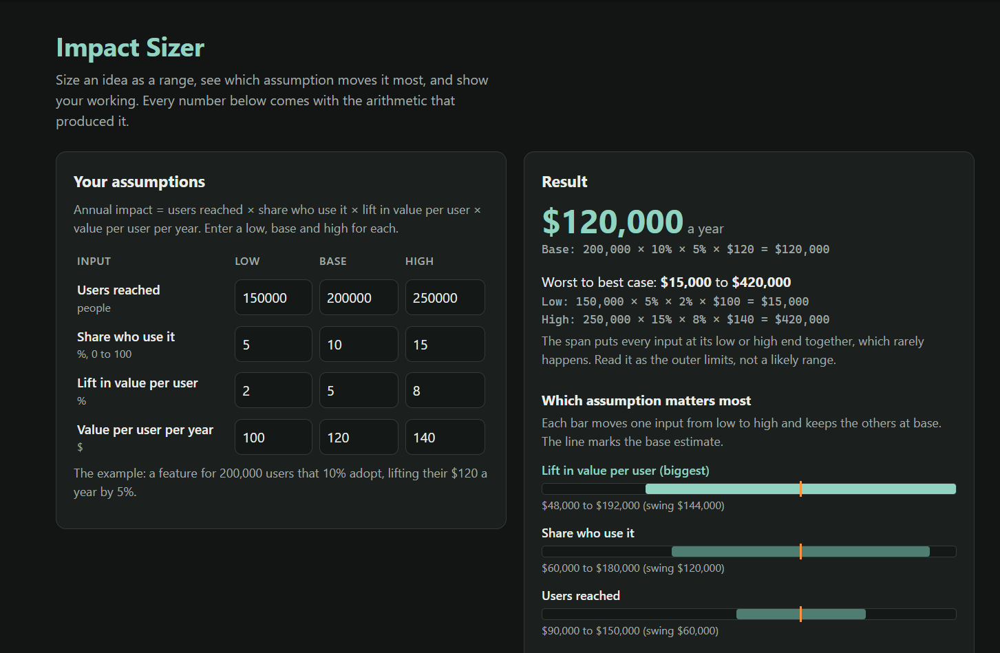

# Impact Sizer

[](https://github.com/gurn3k/impact-sizer/actions/workflows/tests.yml)

**Size a product idea as a range, find the assumption that matters most, and show your working.**

PMs size ideas as one number in a spreadsheet cell. The reviewer can't see how uncertain it is or which assumption it rests on. Impact Sizer takes a low, base and high value for each input and shows:

- the base estimate, with the arithmetic behind it
- the worst-to-best case span, with the arithmetic behind each end
- every input ranked by how much it swings the result, drawn to scale
- a summary paragraph to paste into a PRD

**The rule it's built around: every number shows the arithmetic that produced it.** You can redo any result with a phone calculator. If the inputs can't produce a trustworthy number, the page shows none and says which field to fix.



## The formula
Annual impact = users reached × share who use it × lift in value per user × value per user per year.

The worked example: 200,000 users × 10% × 5% × $120 = **$120,000 a year**, with a worst-to-best span of $15,000 to $420,000. Lift drives it most ($48,000 to $192,000), so lift is the assumption to check first.

## How I know it's right
- **Hand-computed answers first.** The answers in `fixtures/worked-examples.json` were worked out by hand before any code existed, including a no-uncertainty control. The tests check the code against them.
- **50 automated tests:**
  - every promise in the PRD
  - a 500-case random check that low ≤ base ≤ high
  - a check that the page's pre-filled example matches the fixture
  - a regression test for each finding
- **An adversarial pass** found six problems, all fixed. The worst: `0,5` was silently read as 5. See [docs/FINDINGS.md](docs/FINDINGS.md).
- **An owner review with a real sizing** found three more, and a pre-ship locale check found a fourth, all fixed. The worst: a percentage typed as a fraction (`0.017` for 1.7%) gave a result 100 times too small. The page now warns.

## Limits
- **One formula shape.** Cost savings and time saved don't fit it yet.
- **The span is wide on purpose.** It puts every input at its extreme together, which rarely happens. Read it as the outer limits, not a likely range.
- **Untested with users.** No PM has used it yet.
- **Only checked in Chrome.** The owner has looked at it in Chrome on desktop and in phone emulation. It hasn't been checked on a real phone or in other browsers.

## Run it
```
npm test     # Node 22, no dependencies
npm start    # http://127.0.0.1:4318
```

## How it was built
The project has:
- a research summary
- a PRD with testable promises
- three decision records
- four tickets
- hand-computed fixtures
- the build itself
- a smoke run and an adversarial pass, with fixes

See [research/summary.md](research/summary.md), [docs/PRD.md](docs/PRD.md), [docs/adr/](docs/adr/), [docs/BUILD-REPORT.md](docs/BUILD-REPORT.md).

## License
MIT
